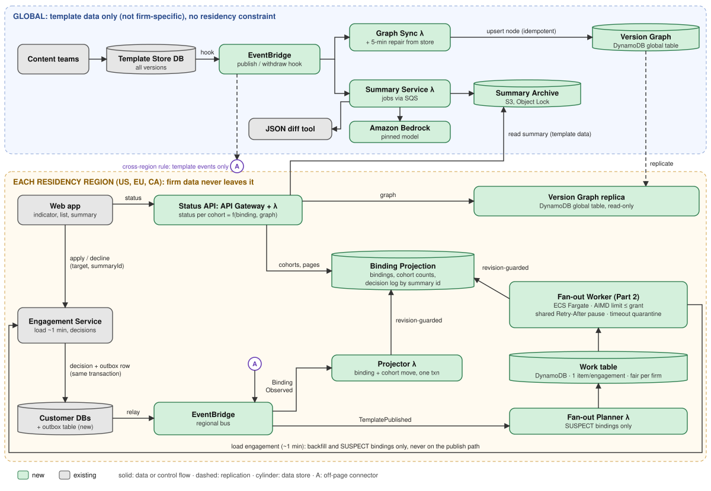
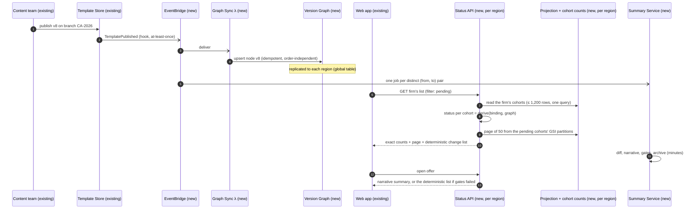
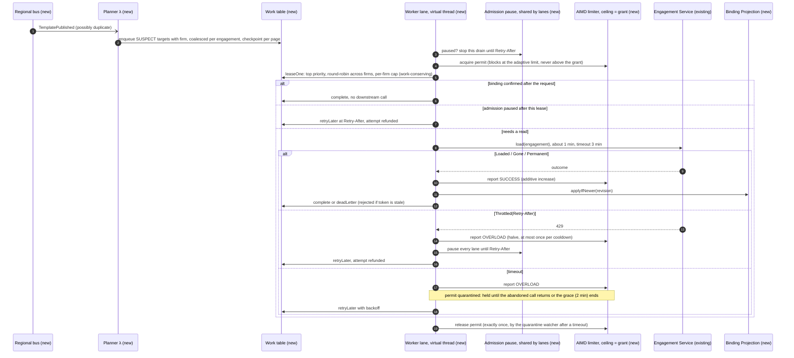
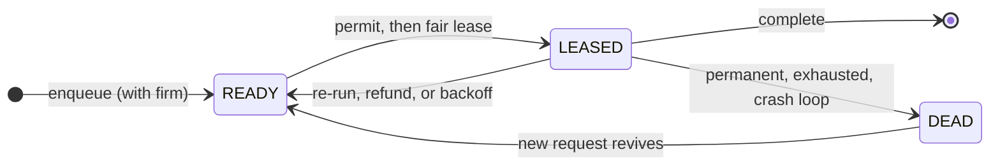
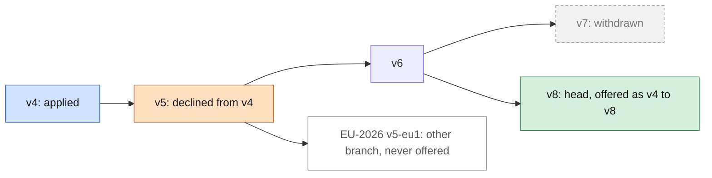

# Diagrams

Diagram 1 is hand-laid-out SVG (an automatic Mermaid layout of it was unreadable); its generator `diagrams/arch_svg.py --check` verifies with font metrics that text fits its boxes and that no arrow crosses a box or a label. Diagrams 2 to 5 are Mermaid (source below; SVGs in `diagrams/` are rendered from this exact source with mermaid-cli). Every component is marked **new** or **existing** (green or grey in diagram 1).

## 1. Architecture and data boundaries

Template data (global, not firm-specific) flows outward to regions; firm data (bindings, cohort counts, decisions, work items) never leaves its residency region. The Status API reads summaries from the global archive, which holds template-derived text only. The Fan-out Worker is the only caller of the one-minute load, and only for backfill and suspect bindings.

## 2. Main flow: publish to visible indicator

No engagement is loaded on this path. The graph write is visible in each region within seconds; the deterministic change list is available at once and the narrative follows within minutes. An open list picks the change up on its next refresh (no push channel; DESIGN.md §7).

## 3. Part 2: fan-out worker flow

## 4. Work item lifecycle

Transitions from LEASED back to READY: *re-run* when a newer request arrived during the lease; *refund* when throttled or when admission was paused before the call (the attempt does not count); *backoff* after a transient failure or timeout (counts as an attempt). *Complete* covers loaded, gone and already fresh. Two non-transitions are not drawn: enqueueing an item that already exists coalesces into it (maximum priority and freshness), and a LEASED item whose lease expired (a crashed worker) is leased again with a new fencing token and an incremented attempt.

## 5. Version semantics example

The engagement is on v4 and declined v5 (the pin is the pair v4, v5). v7 was published and then withdrawn; v8 replaced it. The offer is v4 → v8, flagged "includes changes you declined in v5". The EU branch is never offered to a CA-2026 engagement. This exact history is the test `VersionSemanticsTest.theDiagramFiveExample`. If CA-2026 also had a published version not contained in v8, the result would be *Needs review* instead of an offer.

